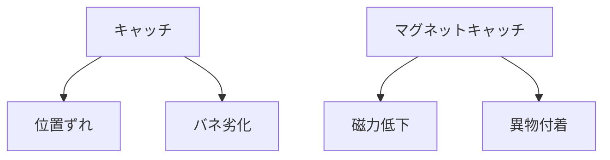

# Day 138: 現場トラブル例

キャッチやマグネットキャッチは、扉や蓋を確実に閉じるための重要な部品です。しかし、現場では様々なトラブルが発生することがあります。今日は、これらのトラブル例を通じて、キャッチやマグネットキャッチの仕組みを理解し、どのように対処すれば良いかを学びましょう。

## トラブル例1: キャッチが閉まらない

**原因と対策**  
キャッチがうまく閉まらない場合、まず考えられるのは位置ずれです。取り付け時にキャッチと受け側の位置がずれていると、正しく閉まらなくなります。この場合、位置を調整することで解決できます。また、キャッチのバネが劣化している場合もあります。この場合は、部品の交換が必要です。

## トラブル例2: マグネットキャッチが弱い

**原因と対策**  
マグネットキャッチの吸着力が弱いと感じる場合、磁力の低下が原因です。これは、磁石自体の劣化や異物の付着が考えられます。異物を取り除くか、磁石を交換することで改善されます。また、取り付け位置が適切でない場合もあるため、位置の再調整も検討してください。

## トラブル例3: キャッチが固い

**原因と対策**  
キャッチが固くて開けづらい場合、主な原因は摩耗や潤滑不足です。摩耗が進むと部品が変形し、動きが悪くなります。この場合、潤滑剤を使用して動きを滑らかにするか、必要に応じて部品を交換します。

## 図で理解する

## 今日のポイント
- キャッチの位置ずれやバネ劣化がトラブルの原因
- マグネットキャッチの吸着力低下は磁力や異物が関与
- 固いキャッチは摩耗や潤滑不足が原因

## 明日へのつながり
明日は、キャッチやマグネットキャッチのメンテナンス方法について学び、トラブルを未然に防ぐ方法を探ります。
