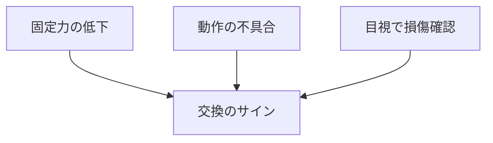

# Day 139: 交換の目安

キャッチやマグネットキャッチは、扉や蓋を固定するために使われる重要な部品です。これらの部品は、使用頻度や環境条件によって劣化し、交換が必要になることがあります。今回は、交換の目安について、図面を読まなくても理解できるように基本的な仕組みと注意点を学びます。

## キャッチ・マグネットキャッチの役割

キャッチは、扉や蓋が閉じた状態を保持するための部品です。マグネットキャッチは、磁力を利用して固定するタイプで、開閉がスムーズに行えるのが特徴です。これらの部品は、日常的に頻繁に使われるため、摩耗や劣化が発生しやすいです。

## 交換の目安

1. **固定力の低下**  
   キャッチやマグネットキャッチの固定力が弱くなったと感じたら、交換のサインです。特にマグネットキャッチは磁力が弱まることがあります。

2. **動作の不具合**  
   扉や蓋がスムーズに開閉しなくなった場合も、交換を検討するべきです。動きが重くなったり、異音がする場合は、内部の摩耗が進んでいる可能性があります。

3. **目視での損傷確認**  
   部品に目立った損傷や錆が見られる場合も交換時期です。特に、屋外や湿気の多い場所で使用される場合、腐食が進行しやすいです。

## 図で理解する

## 今日のポイント
- 固定力の低下は交換のサイン
- 動作の不具合も交換を検討
- 損傷や錆は目視で確認

## 明日へのつながり
明日は、キャッチやマグネットキャッチの交換作業における具体的な手順と注意点について学びます。
