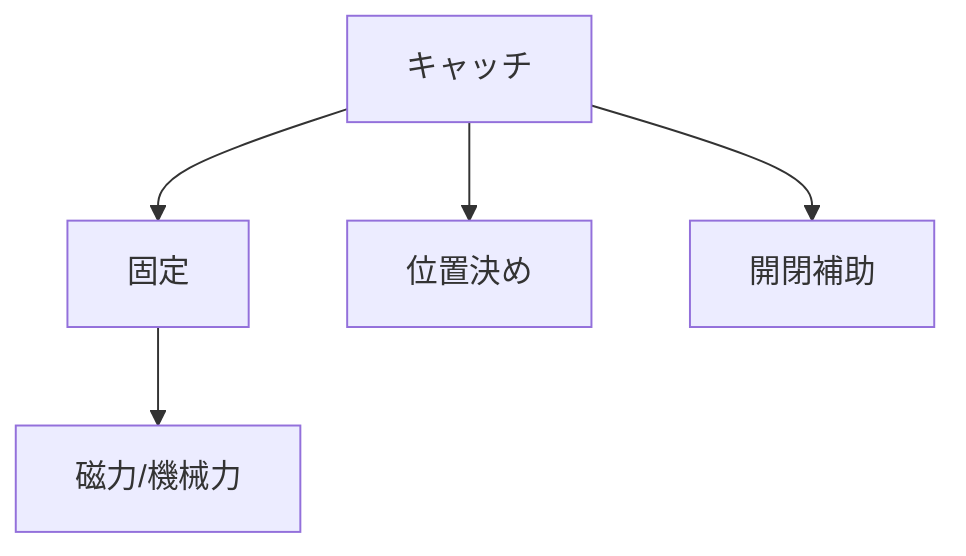

# Day 140: 4社カテゴリの共通点

キャッチ・マグネットキャッチは、ドアや扉を閉じた状態で固定するための機構部品です。今回は、タキゲン、シブタニ（APPIT）、栃木屋、スガツネの4社が提供するキャッチ・マグネットキャッチの共通点を理解し、図面が読めなくてもその仕組みを把握できるようにしましょう。

## キャッチ・マグネットキャッチの基本

キャッチ・マグネットキャッチは、主に以下のような役割を持っています。

1. **固定**: 扉を閉じた状態でしっかりと固定します。これにより、扉が不意に開くことを防ぎます。
2. **位置決め**: 扉を正しい位置に保持します。これにより、扉のズレを防ぎ、見た目の美しさを保ちます。
3. **開閉の補助**: 開閉時に適度な抵抗を提供し、スムーズな操作を可能にします。

## 4社の共通点

### 共通の仕組み

各社のキャッチ・マグネットキャッチには、以下の共通する仕組みがあります。

- **磁力または機械的な力**で扉を固定します。磁力を利用する製品は、マグネットキャッチと呼ばれ、磁石の力で扉を引き寄せて固定します。機械的な力を利用する製品は、スプリングやラッチ機構を用いて固定します。
- **取り付けが簡単**で、多くの場合はネジや接着剤を使用して固定します。これにより、現場での取り付け作業が容易になります。
- **耐久性**が高く、長期間にわたって安定した性能を発揮します。素材には、耐久性のある金属やプラスチックが使用されます。

## 図で理解する

## 今日のポイント
- キャッチは扉を固定し、位置を決める
- 磁力と機械力の2種類がある
- 取り付けが簡単で耐久性が高い

## 明日へのつながり
次回は、キャッチ・マグネットキャッチの選定基準について詳しく学び、用途に応じた最適な選択方法を探ります。
