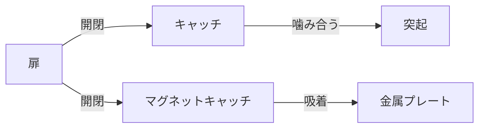

# Day 141: 図なしで説明する練習

キャッチやマグネットキャッチは、扉や蓋をしっかりと閉じた状態に保つための部品です。これらは、家具や産業機器、電子機器のカバーなど、さまざまな場面で使用されています。今日は、図面が読めなくても理解できるように、これらの部品の仕組みを言葉だけで説明する練習をしましょう。

まず、**キャッチ**についてです。キャッチは、通常、扉や蓋の内側に取り付けられ、相手側に取り付けられた突起やフックと噛み合うことで、扉を閉じた状態に保ちます。この仕組みは、手で開ける際に少し力を加えると外れるようになっています。これにより、簡単に開閉が可能です。

次に、**マグネットキャッチ**についてです。マグネットキャッチは、磁石の力を利用して扉や蓋を閉じた状態に保ちます。通常、扉側に金属プレートが取り付けられ、キャッチ側には磁石が組み込まれています。扉を閉じると、磁石が金属プレートを引き寄せ、しっかりと固定します。開ける際は、磁力を超える力を加える必要がありますが、通常の使用では問題なく開閉できます。

これらの部品の選定は、使用する環境や求められる保持力によって異なります。例えば、軽い扉には小さなキャッチや弱い磁力のマグネットキャッチが適していますが、重い扉や強い保持力が必要な場合には、より強力なものを選ぶ必要があります。

## 図で理解する

## 今日のポイント
- キャッチは噛み合いで固定
- マグネットキャッチは磁力で固定
- 使用環境で選定が重要

## 明日へのつながり
明日は、キャッチ・マグネットキャッチの選定基準について詳しく学びます。どのような条件でどのタイプを選ぶべきかを理解しましょう。
