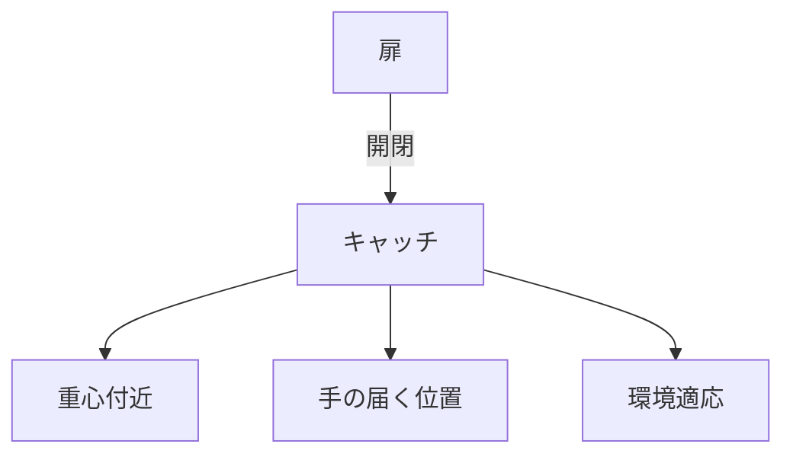

# Day 142: 取付位置の考え方

キャッチやマグネットキャッチは、扉や蓋を閉じた状態で固定するための部品です。これらの部品は、正しい位置に取り付けることで最大限の効果を発揮します。今回は、図面が読めない方でも理解できるように、取付位置の考え方を解説します。

## キャッチ・マグネットキャッチの仕組み

キャッチやマグネットキャッチは、扉や蓋を閉じたときにしっかりと固定し、開けるときには簡単に外れるように設計されています。これにより、扉や蓋が意図せず開かないようにすることができます。

## 取付位置の基本的な考え方

1. **扉の重心を考慮する**  
   キャッチやマグネットキャッチは、扉の重心に近い位置に取り付けると、扉が安定して閉まります。重心から離れた位置に取り付けると、扉が傾いたり、開閉がスムーズでなくなることがあります。

2. **使用頻度を考慮する**  
   よく使用する扉や蓋には、開閉がしやすい位置にキャッチを取り付けることが重要です。手が届きやすい位置や、力を入れやすい位置に取り付けると、使い勝手が向上します。

3. **環境条件を考慮する**  
   湿気や温度変化が大きい環境では、素材や取り付け方法に注意が必要です。特にマグネットキャッチは、磁力が弱まることがあるため、環境に適した製品を選び、適切な位置に取り付けることが重要です。

## 図で理解する

## 今日のポイント
- キャッチは扉の重心に近い位置に
- 使用頻度を考慮した位置に取り付け
- 環境条件に適した位置と製品選び

## 明日へのつながり
次回は、キャッチ・マグネットキャッチの耐久性について学び、長期間使用するためのポイントを探ります。
