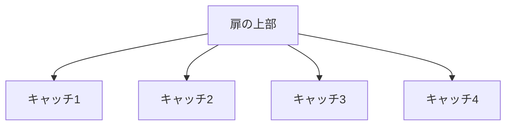

# Day 143: 複数キャッチの配置

キャッチやマグネットキャッチは、扉や蓋がしっかりと閉まるようにするための部品です。これらの部品を複数配置することで、より安定した固定が可能になります。今回は、図面が読めなくても理解できるように、複数キャッチの配置について説明します。

## 複数キャッチの役割

キャッチを複数配置することで、以下のような利点があります。

1. **安定性の向上**: 扉や蓋が大きい場合、1つのキャッチでは不安定になることがあります。複数のキャッチを配置することで、全体の安定性が向上します。

2. **安全性の確保**: 特に重い扉や頻繁に開閉する扉では、複数のキャッチを使うことで、万が一の外れを防ぎ、安全性を高めます。

3. **均等な力の分散**: 複数のキャッチを配置することで、力が均等に分散され、キャッチ自体の耐久性も向上します。

## 配置の基本原則

キャッチを配置する際には、以下の基本原則を考慮します。

- **対称配置**: 扉の左右や上下に対称に配置することで、バランスが良くなります。
- **距離の均等化**: キャッチ同士の距離を均等にすることで、力の分散が均一になります。
- **使用頻度に応じた配置**: 開閉頻度が高い部分には、特にしっかりとキャッチを配置することが重要です。

## 図で理解する

以下の図は、複数キャッチの配置の一例を示しています。

## 今日のポイント
- 複数キャッチで安定性向上
- 力を均等に分散
- 対称配置でバランス良好

## 明日へのつながり
次回は、複数キャッチ配置の具体的な事例を通じて、さらに深く理解を進めていきます。
