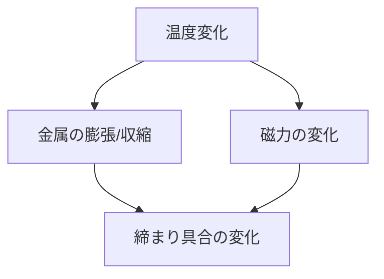

# Day 144: 温度の影響

キャッチやマグネットキャッチは、ドアやパネルをしっかりと固定するための重要な部品です。これらの部品は、温度の変化によりその性能が影響を受けることがあります。今日は、温度がこれらの部品にどのような影響を与えるのかを学び、適切な選定と使用方法について考えてみましょう。

## 温度の影響とは？

キャッチやマグネットキャッチは、主に金属や磁石を使用して作られています。これらの材料は、温度の変化により物理的な性質が変わることがあります。例えば、金属は温度が上がると膨張し、下がると収縮します。この変化がキャッチの位置や締まり具合に影響を与えることがあります。

### 金属の膨張と収縮

金属製のキャッチは、温度の上昇により膨張し、逆に温度が下がると収縮します。これにより、キャッチの位置が微妙に変わり、ドアやパネルの締まり具合が変わることがあります。特に、極端な温度変化がある環境では、この影響が顕著になることがあります。

### 磁石の性能変化

マグネットキャッチに使用される磁石も温度の影響を受けます。一般的に、磁石の磁力は高温で弱くなり、低温で強くなる傾向があります。これにより、ドアやパネルの固定力が変わる可能性があります。特に、極端な高温環境では、磁力が大幅に低下することがあるため注意が必要です。

## 適切な選定と使用方法

温度の影響を考慮したキャッチやマグネットキャッチの選定と使用方法を理解することは重要です。以下のポイントを参考にしてください。

1. **使用環境の確認**: 使用する環境の温度範囲を確認し、その範囲に適した材料を選びましょう。
2. **定期的な点検**: 温度変化が激しい環境では、定期的にキャッチの状態を点検し、必要に応じて調整や交換を行いましょう。
3. **適切な素材選び**: 特殊な環境では、耐熱性や耐寒性に優れた素材を選ぶことが重要です。

## 図で理解する

## 今日のポイント
- 温度変化は金属の膨張/収縮に影響
- 磁力は高温で弱く、低温で強くなる
- 適切な素材と定期点検が重要

## 明日へのつながり
明日は、キャッチ・マグネットキャッチの耐久性について学び、長期間使用するためのポイントを探ります。
