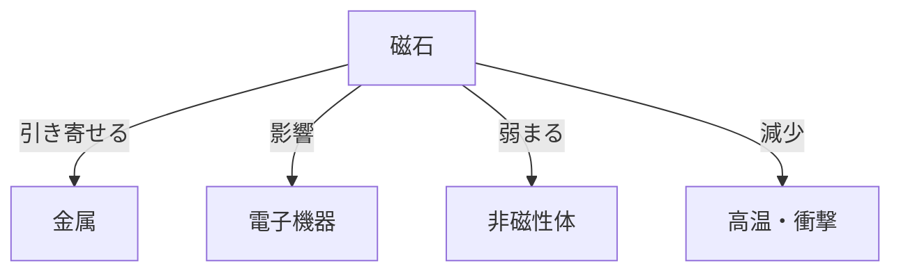

# Day 145: 磁気の注意点

キャッチ・マグネットキャッチは、磁力を利用して扉や蓋を固定するための機構部品です。これらの部品は、簡単に開閉できるように設計されていますが、磁気の特性を理解しておかないと、意図しないトラブルを引き起こすことがあります。今日はその「磁気の注意点」について学びましょう。

まず、磁気は金属を引き寄せる力を持っていますが、その力は距離や障害物の影響を受けます。例えば、マグネットキャッチを取り付ける際に、間に非磁性体（磁力を通さない素材）があると、磁力が弱まることがあります。これは、取り付ける場所や素材を選ぶ際に考慮すべき重要なポイントです。

次に、磁力は時間とともに弱まることがあります。特に、強い衝撃や高温にさらされると、磁力が減少することがあります。したがって、マグネットキャッチを使用する環境や条件を事前に確認し、適切な製品を選定することが重要です。

さらに、磁気は他の電子機器に影響を与える可能性があります。例えば、磁石の近くに電子機器を置くと、誤作動を引き起こすことがあります。これは、特に精密機器を扱う現場で注意が必要です。磁石を使用する際には、周囲の環境や機器への影響を考慮し、適切な対策を講じることが求められます。

## 図で理解する

## 今日のポイント
- 磁力は距離と障害物で弱まる
- 磁力は時間や環境で減少する
- 磁気は電子機器に影響を与える

## 明日へのつながり
明日は、キャッチ・マグネットキャッチの取り付け方法について学び、実際の使用シーンでの応用力を高めましょう。
