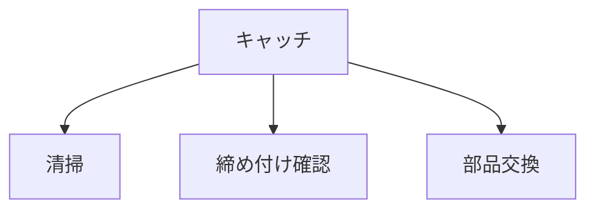

# Day 146: メンテナンス

キャッチやマグネットキャッチは、ドアや蓋をしっかりと固定するための重要な部品です。これらの部品は、日常的に使用されるため、定期的なメンテナンスが必要です。メンテナンスを怠ると、固定力が低下したり、部品が壊れやすくなったりすることがあります。今回は、図面が読めない方でも理解できるように、キャッチ・マグネットキャッチのメンテナンスの基本について解説します。

## メンテナンスの基本

### 1. 清掃

キャッチやマグネットキャッチは、埃や汚れがたまりやすい部分です。定期的に柔らかい布で拭き取ることで、動きがスムーズになります。特にマグネットキャッチは、磁力が埃や金属片を引き寄せやすいため、注意が必要です。

### 2. 締め付けの確認

取り付けネジが緩んでいると、キャッチの機能が低下します。定期的にネジを確認し、必要に応じて締め直してください。ただし、強く締めすぎると部品を傷める可能性があるので、適度な力で行いましょう。

### 3. 部品の交換

キャッチやマグネットキャッチは、長期間の使用で摩耗します。摩耗が進むと、ドアや蓋の固定が不安定になることがあります。定期的に部品を点検し、摩耗が激しい場合は交換を検討してください。交換の際は、同じ種類の部品を選ぶことが重要です。

## 図で理解する

## 今日のポイント
- 定期的な清掃で動きをスムーズに
- 締め付け確認で機能を維持
- 摩耗した部品は早めに交換

## 明日へのつながり
明日は、キャッチ・マグネットキャッチの選び方について学びます。メンテナンスの知識を活かして、最適な部品を選ぶ方法を理解しましょう。
