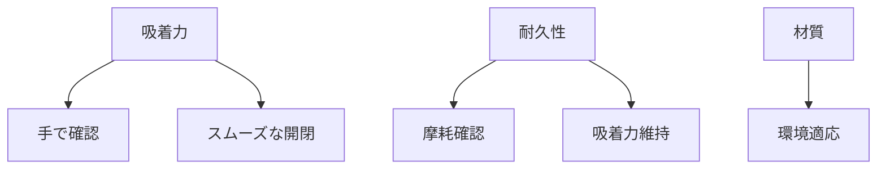

# Day 147: 品質確認のポイント

キャッチ・マグネットキャッチは、扉や蓋をしっかりと固定するための部品です。これらの部品の品質を確認することは、製品全体の信頼性を高めるために重要です。本日は、図面が読めなくても理解できるように、キャッチ・マグネットキャッチの品質確認のポイントを解説します。

## 1. 吸着力の確認

キャッチやマグネットキャッチの最も重要な機能は、扉や蓋をしっかりと保持する吸着力です。この吸着力が不足していると、扉が勝手に開いてしまうことがあります。吸着力は、実際に手で開閉を試みることで確認できます。スムーズに開閉でき、適度な力でしっかりと閉まることが理想です。

## 2. 耐久性の確認

キャッチ・マグネットキャッチは、長期間にわたって使用されることが多いため、耐久性も重要な品質の一部です。耐久性は、繰り返し使用した際の摩耗や劣化の程度を確認することで評価できます。特に、開閉を繰り返した後も吸着力が維持されているかをチェックしましょう。

## 3. 材質の確認

品質確認において、材質の確認も欠かせません。キャッチ・マグネットキャッチは、金属やプラスチックなどさまざまな材質で作られています。使用環境に適した材質を選ぶことで、腐食や破損を防ぐことができます。例えば、湿気の多い場所では耐腐食性の高い材質が望ましいです。

## 図で理解する

## 今日のポイント
- 吸着力は手で確認
- 耐久性は摩耗をチェック
- 材質は使用環境に適応

## 明日へのつながり
明日は、キャッチ・マグネットキャッチの取り付け方法について詳しく学びます。取り付けの正確さが品質にどのように影響するかを理解しましょう。
